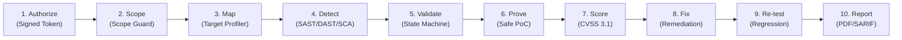
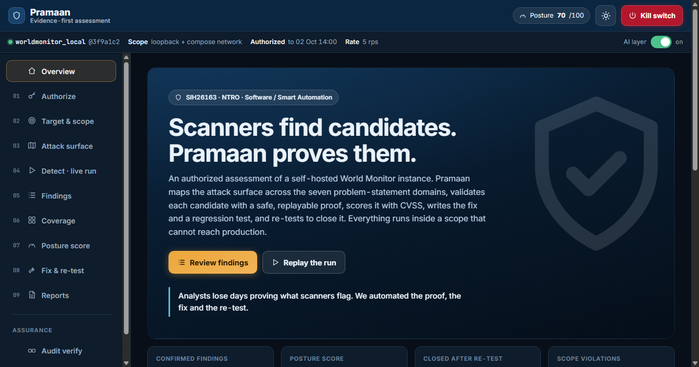
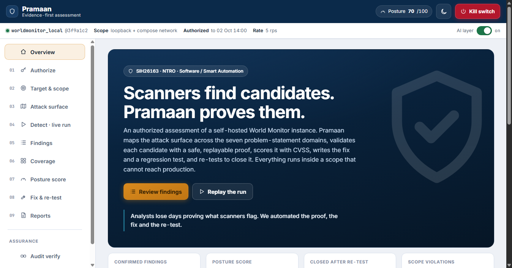
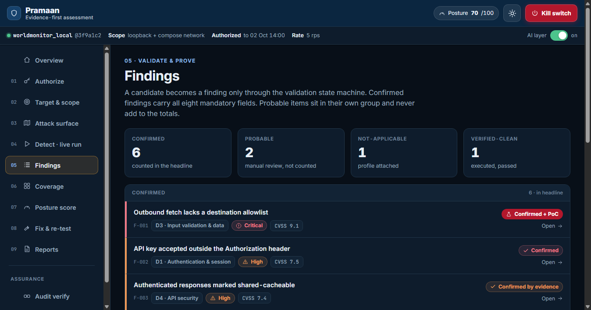
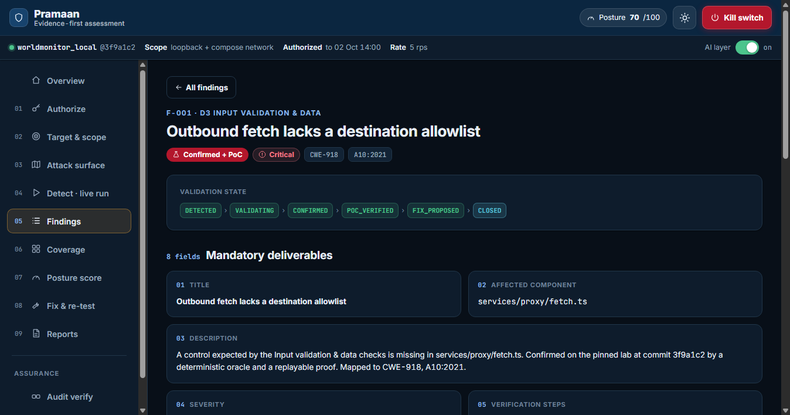
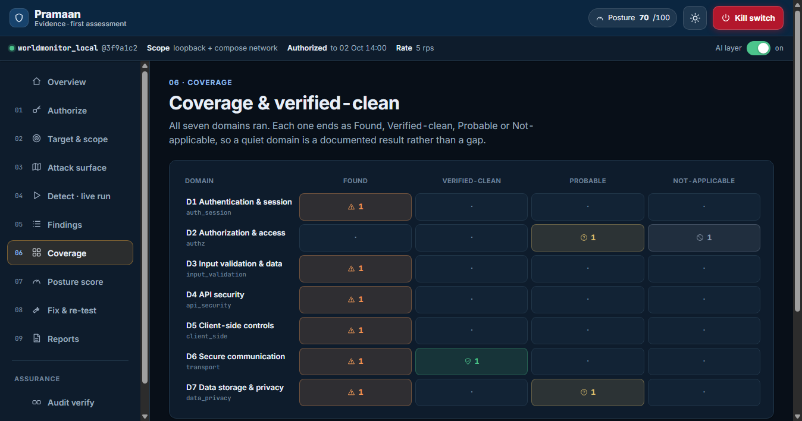
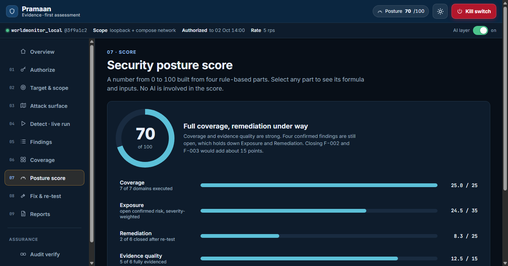
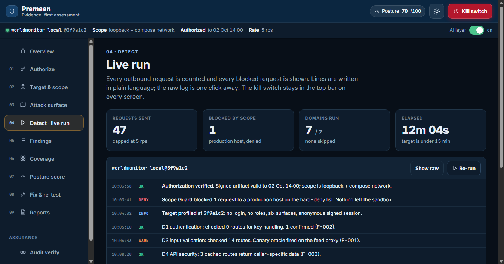
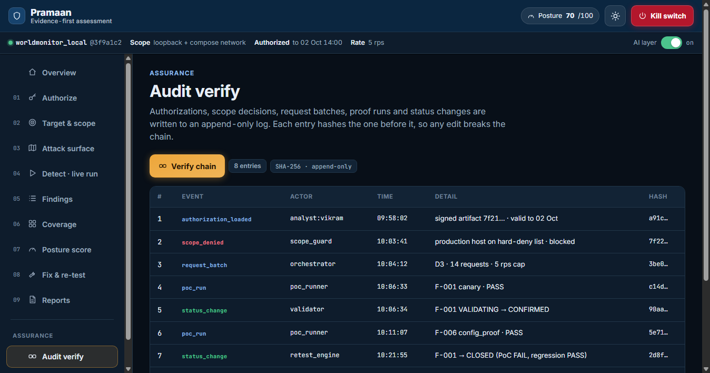

<div align="center">

# Pramaan

### Evidence-first security assessment: scanners find candidates, Pramaan proves them.

[](https://pramaan-sih26163.vercel.app)
[](https://www.youtube.com/watch?v=5EYjylzjHAI)
[](LICENSE)
[](https://sih.gov.in)
[-amber?style=for-the-badge)](#project-status)
[](#technology-stack)
[](https://pramaan-sih26163.vercel.app)

---

### [🌐 Live Interactive Demo](https://pramaan-sih26163.vercel.app) &nbsp;·&nbsp; [🎥 Video Walkthrough](https://www.youtube.com/watch?v=5EYjylzjHAI) &nbsp;·&nbsp; [📄 Technical PRD (PDF)](docs/PRD.pdf)

---

[](https://www.youtube.com/watch?v=5EYjylzjHAI)

*Click the thumbnail above to watch the walkthrough on YouTube.*

</div>

---

## 1. The Problem

**Smart India Hackathon 2026 — Problem Statement SIH26163**  
**Organisation:** National Technical Research Organisation (NTRO)  
**Title:** Security Assessment of the World Monitor application  
**Category / Theme:** Software / Smart Automation  

The problem statement asks for an authorized security assessment of the open-source **World Monitor** platform. The mandate comprises four key tasks across seven technical domains:

1. **Identify vulnerabilities** across the application stack.
2. **Assess the impact** of each discovered weakness.
3. **Demonstrate proof-of-concept (PoC) exploitation** in a strictly controlled environment.
4. **Recommend practical remediation** and re-test to verify resolution.

### The 7 Assessment Domains
- **D1: Authentication and Session Management** (key handling, token lifecycles, session binding)
- **D2: Authorization and Access Control** (BOLA/IDOR, tier/role gating, IPC capability scopes)
- **D3: Input Validation and Data Handling** (SSRF, feed injection, XSS, unsafe sinks)
- **D4: API Security** (contract drift, cache key collisions, CORS policies, WebSocket origin)
- **D5: Client-Side Security Controls** (CSP strength, SRI, service workers, storage leakage)
- **D6: Secure Communication Mechanisms** (TLS cipher suites, HSTS, loopback bindings)
- **D7: Data Storage and Privacy Protections** (hardcoded secrets, PII redaction, SCA, DPDPA 2023)

### The 8 Mandatory Per-Finding Deliverables
The problem statement strictly requires eight specific fields for every documented finding:
1. `Title` &nbsp;·&nbsp; 2. `Description` &nbsp;·&nbsp; 3. `Affected Component` &nbsp;·&nbsp; 4. `Severity Rating (CVSS)`  
5. `Steps to Reproduce` &nbsp;·&nbsp; 6. `Safe Proof-of-Concept` &nbsp;·&nbsp; 7. `Business Impact` &nbsp;·&nbsp; 8. `Remediation Recommendations`

---

## 2. Why Pramaan is Different

Most automated security tools stop at **detection**. A scanner generates hundreds of raw candidate alerts, leaving analysts to spend days manually triaging, reproducing, scoring, and drafting reports. 

> **Detection is a commodity. Proof, scoring, remediation, and re-testing are the bottleneck.**  
> Pramaan is the validation-and-reporting layer that automates proof, fix generation, and re-testing inside a hard network scope lock.

| Typical Scanner Approach | The Pramaan Approach |
|---|---|
| **Demo on artificial clone:** Demoed only against a deliberately broken toy app. | **Real target at pinned commit:** Tested against real self-hosted World Monitor (`AGPL-3.0`); an internal Golden Lab is used strictly to prove tool precision. |
| **"Detected" = "Vulnerable":** Raw alerts are reported as confirmed findings. | **State machine verification:** Nothing becomes a finding until it reaches `CONFIRMED` via deterministic oracles or a two-signal rule ([docs/architecture.md](docs/architecture.md)). |
| **Silent on clean controls:** Emits nothing when a component is secure. | **Verified-Clean reporting:** Reports `Verified-Clean` with verifiable evidence per check; a hardened defense is a documented result, not a failure. |
| **Static PDF dump:** Generates an untestable PDF at the end. | **Continuous re-test loop:** Generates automated regression test scripts and re-runs PoCs post-fix to verify closure before report generation. |
| **Unbounded network access:** Tool can inadvertently target external hosts. | **Kernel/Network Scope Guard:** Hard-denies production domains (`worldmonitor.app`) at the network layer; out-of-scope traffic is technically impossible. |

---

## 3. Assessment Pipeline

Pramaan executes every assessment across a structured 10-stage execution pipeline:



---

## 4. Key Features

### 🛡️ Safety & Scope Enforcement
- **Scope Guard Proxy:** Enforces RFC 1918 loopback boundaries and a hard-deny list (`worldmonitor.app`, upstream APIs). All outbound traffic is strictly trapped in an isolated Docker sandbox.
- **Immediate Kill Switch:** Accessible globally across CLI and UI; terminates all active workers and probes within 2 seconds.
- **Deterministic Rate Capping:** Token-bucket limiter restricts probes to safe thresholds (default: 5 rps).

### 🔬 Validation & Evidence Quality
- **Deterministic Oracles:** Uses canary listeners, config diffing, and differential dual-identity testing to confirm weaknesses without destructive payloads.
- **Finding State Machine:** Moves findings through `DETECTED → VALIDATING → CONFIRMED → POC_VERIFIED → FIX_PROPOSED → CLOSED`. Unvalidated alerts remain in an appendix and are excluded from headline totals.
- **Mandatory 8 Fields:** The platform strictly enforces that a finding cannot be confirmed unless all eight SIH deliverables are complete.

### 📊 Auditable Scoring
- **Zero-AI Severity:** CVSS v3.1 base vectors and scores are calculated mathematically using the deterministic `cvss` library—never estimated by an LLM.
- **Security Posture Score (0–100):** A transparent, explainable metric evaluating Coverage (25 pts), Exposure (35 pts), Remediation (25 pts), and Evidence Quality (15 pts). Zero findings never defaults to 100.

### 🔄 Remediation & Automated Re-test
- **Root Cause & Patch Guidance:** Generates code-level diffs and configuration guidance for confirmed weaknesses.
- **Failing-then-Passing Tests:** Auto-generates regression test scripts (Playwright / pytest) that fail prior to remediation and pass once the patch is applied.
- **Re-test Engine:** Closes findings only after re-running the PoC and verifying regression test success.

### 📋 Transparent Reporting & Audit Trail
- **SHA-256 Hash-Chained Audit Log:** Maintains an append-only, tamper-evident log of every authorization, outbound request batch, PoC run, and status change.
- **Multi-Format Export:** Executive summaries, technical breakdowns, Markdown tickets, and SARIF 2.1.0 bundles for CI/CD integration.

---

## 5. Project Status

In strict adherence to our project honesty principles, the table below delineates what is built today versus what is designed in the PRD and on the future roadmap:

| Component / Feature | Classification | Status | Evidence / Location |
|---|:---:|:---:|---|
| **Interactive Prototype UI** | P0 | ✅ **Built** | Deployed at [pramaan-sih26163.vercel.app](https://pramaan-sih26163.vercel.app); covers screens S0–S7, S9 |
| **Illustrative Demo Dataset** | P0 | ✅ **Built** | [data.js](data.js); models the 8 mandatory fields, 7 domains, and audit chain |
| **Vercel Cloud Deployment** | P0 | ✅ **Built** | Zero-dependency static site with strict CSP & security headers ([vercel.json](vercel.json)) |
| **Technical PRD Document** | P0 | ✅ **Built** | [docs/PRD.pdf](docs/PRD.pdf); 17-page build specification |
| **CI Quality Workflow** | P0 | ✅ **Built** | [.github/workflows/ci.yml](.github/workflows/ci.yml); JS syntax, HTML parsing, link integrity |
| **Full Architecture & Methodology Specs** | P0 | ✅ **Built** | [docs/architecture.md](docs/architecture.md) & [docs/assessment-methodology.md](docs/assessment-methodology.md) |
| **Python FastAPI Backend Core** | P0 | 📐 Designed in PRD | Specified in [PRD §6](docs/PRD.pdf); planned single-service API |
| **Scope Guard Network Proxy** | P0 | 📐 Designed in PRD | Logic specified in [PRD §11.3](docs/PRD.pdf) & [docs/architecture.md](docs/architecture.md) |
| **Automated SAST/DAST/SCA Engines** | P0 | 📐 Designed in PRD | Semgrep, async httpx probes, OSV-Scanner integration planned |
| **Canary Safe PoC Runner** | P0 | 📐 Designed in PRD | Specified in [PRD §11](docs/PRD.pdf); non-destructive canary listener |
| **Automated Fix Diff & Re-test Engine** | P1 | 📐 Designed in PRD | Specified in [PRD §12](docs/PRD.pdf); regression test generator |
| **Continuous Monitoring / Drift Mode** | P2 | 🗺 Roadmap | Wireframed in prototype; engine not built ([docs/roadmap.md](docs/roadmap.md)) |
| **Mobile Binary Analysis (APK/IPA)** | P2 | 🗺 Roadmap | Long-term planned capability |

---

## 6. Screenshots of the Live Platform

The following screenshots are captured directly from the live deployment at [pramaan-sih26163.vercel.app](https://pramaan-sih26163.vercel.app):

### Dashboard & Overview
| Dark Theme (Default) | Light Theme |
|:---:|:---:|
|  |  |

### Findings List & Finding Detail (Mandatory 8 Fields)
| Findings List View | Finding Detail Card (F-001) |
|:---:|:---:|
|  |  |

### Coverage Matrix & Security Posture Score
| 7-Domain Coverage Matrix | Posture Score Breakdown (0–100) |
|:---:|:---:|
|  |  |

### Live Run Console & Audit Trail
| Live Run Console | Hash-Chained Audit Log |
|:---:|:---:|
|  |  |

---

## 7. Architecture Overview

```
pramaan-sih26163/
├── index.html, styles.css, app.js, data.js   # Built prototype UI & demo state
├── vercel.json                               # Strict CSP & security headers
├── docs/
│   ├── PRD.pdf                               # Original 17-page engineering PRD
│   ├── architecture.md                       # Mermaid architecture & Scope Guard flows
│   ├── assessment-methodology.md             # Tiers, validation rules & formulas
│   ├── scope-and-ethics.md                   # Rules of engagement & legal compliance
│   ├── roadmap.md                            # P0/P1/P2 build matrix
│   ├── demo-data.md                          # Schema and data contracts
│   └── screenshots/                          # Live UI captures
└── .github/
    ├── workflows/ci.yml                      # CI validation workflow
    ├── ISSUE_TEMPLATE/                       # Bug & feature templates
    └── CODEOWNERS                            # Maintainer assignments
```

For comprehensive architectural specifications and data flow diagrams, see [docs/architecture.md](docs/architecture.md).

---

## 8. Technology Stack

### Current Implementation (Interactive Prototype)
- **Frontend:** Vanilla HTML5, CSS3 (Custom Design System with CSS variables), Modern ES6+ JavaScript.
- **Runtime:** Dependency-free; runs directly in modern browsers without compilation.
- **Hosting:** Vercel Edge Network with strict Content-Security-Policy headers.

### Planned Production Stack (PRD Specification)
- **Frontend:** React 18, Vite, TypeScript, Tailwind CSS.
- **Backend API:** Python 3.12, FastAPI (async execution loop).
- **Database:** PostgreSQL (production / hosted demo) / SQLite (local zero-setup mode).
- **Assessment Engines:** Semgrep CE (SAST), custom `httpx` async probes (DAST), OSV-Scanner & npm audit (SCA).
- **Execution Sandbox:** Docker Compose with isolated network bridge (zero internet egress).
- **Reporting:** WeasyPrint (HTML-to-PDF engine), SARIF 2.1.0 JSON exporters.
- **AI Gateway:** Optional air-gapped local model (Ollama) or single serverless function; strict 2500ms fallback.

---

## 9. Running Locally

Because the prototype has zero external dependencies and requires no compilation step, you can run it locally with any static HTTP server:

### Option 1: Python HTTP Server (Recommended)
```bash
# Clone the repository
git clone https://github.com/drv653/pramaan-sih26163.git
cd pramaan-sih26163

# Start a local static server
python -m http.server 8080
```
Open **[http://localhost:8080](http://localhost:8080)** in your browser.

### Option 2: Node.js Serve
```bash
npx serve .
```

### Deploying to Vercel
1. Import the repository on [Vercel](https://vercel.com).
2. Framework Preset: **Other**.
3. Build Command: Leave **empty**.
4. Output Directory: Leave **empty** (or root `./`).
5. Deploy. All security headers in [vercel.json](vercel.json) will apply automatically.

---

## 10. Responsible Use & Ethics

Pramaan is engineered strictly for authorized security assessments:
- **Authorized Testing Only:** Testing must only be conducted against systems you own or have explicit, documented authorization to test.
- **No Production Impact:** Never target production environments or public services (`worldmonitor.app` is hard-denied in code).
- **No Denial of Service:** Availability is assessed through static analysis of bounds and rate limits, never through traffic flooding.
- **Safe Proofs of Concept:** Exploitation is strictly limited to non-destructive proof-of-existence canary signals.
- **Coordinated Disclosure:** Upstream findings must be reported through the project's official `SECURITY.md` channel before public disclosure.

For details, consult [SECURITY.md](SECURITY.md) and [docs/scope-and-ethics.md](docs/scope-and-ethics.md).

---

## 11. Roadmap

Development follows a three-phase milestone plan:
- **P0 (Demo-Critical Baseline):** Complete CLI, Scope Guard, Target Profiler, core 25 checks, Safe PoC runner, deterministic scoring, and WeasyPrint PDF reports.
- **P1 (High-Priority Extensions):** Differential authorization testing, auto-generated fix diffs and regression tests, ZAP baseline engine, SARIF export, Hindi localization.
- **P2 (Long-Term Vision):** Continuous configuration drift monitoring, mobile APK/IPA analysis, and fleet analytics.

See [docs/roadmap.md](docs/roadmap.md) for the full milestone tracker.

---

## 12. Team

**Smart India Hackathon 2026 — Team Members**

| Member | Role | GitHub Profile |
|---|---|:---:|
| **Dhruv Dubey** | Repo Owner & Lead | [@drv653](https://github.com/drv653) |
| **Naman Sharma** | Team Member | [@namancantcode67](https://github.com/namancantcode67) |
| **Mohib Saiyed** | Team Member | [@Mohib-444](https://github.com/Mohib-444) |

> *Note: Additional teammates and contributors may be added as hackathon development progresses.*

---

## 13. License & Acknowledgements

### License
This project is licensed under the **MIT License** — see the [LICENSE](LICENSE) file for details.  
Copyright © 2026 Dhruv Dubey.

### Standards & Methodologies
Pramaan is grounded in established international cybersecurity standards:
- **NIST SP 800-115:** Technical Guide to Information Security Testing and Assessment
- **OWASP Foundation:** Application Security Verification Standard (ASVS v4.0.3), Web Security Testing Guide (WSTG v4.2), OWASP Top 10 (2021), and API Security Top 10 (2023)
- **MITRE Corporation:** Common Weakness Enumeration (CWE)
- **FIRST:** Common Vulnerability Scoring System (CVSS v3.1)
- **Open Source Vulnerabilities (OSV):** Distributed vulnerability database & CycloneDX SBOM

### Assessment Target Attribution
The assessment target specified by NTRO for SIH26163 is the open-source **[World Monitor](https://github.com/koala73/worldmonitor)** project (licensed under AGPL-3.0). Pramaan is an independent assessment project created for Smart India Hackathon 2026 and is not affiliated with or endorsed by the World Monitor project. No World Monitor proprietary source code is distributed within this repository.
