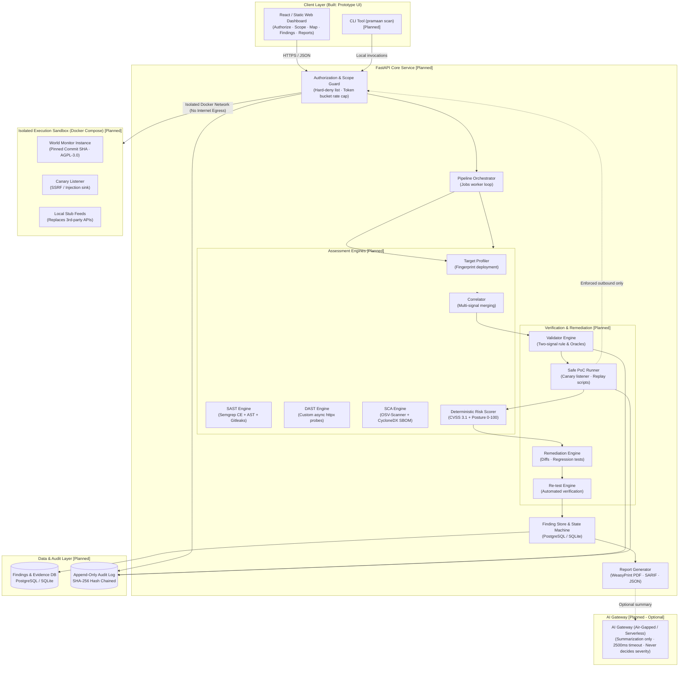
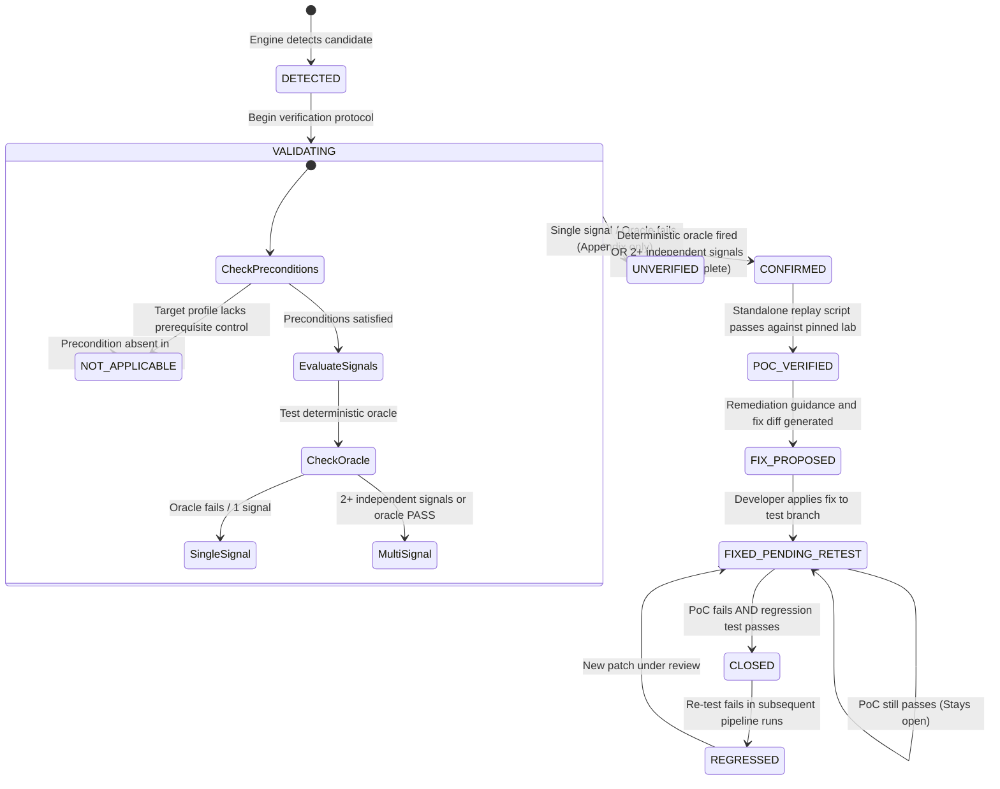

# Pramaan System Architecture

> **Architecture Status:** 📐 **Planned Architecture** (except the **Client Dashboard UI**, which is built as an interactive prototype).
> The pipeline, orchestrator, scanner engines, safe PoC runner, and scope guard are fully specified in [PRD §6](PRD.pdf) and scheduled across build milestones.

---

## 1. High-Level System Architecture

The following diagram illustrates the target architecture specified in **PRD §6**. All outbound interaction flows strictly through the **Scope Guard**, enforcing isolated network boundaries and authorization windows before any network packet is dispatched.



---

## 2. Finding State Machine

As mandated in **PRD §10.1**, a candidate weakness detected by any engine is never treated as a vulnerability until it satisfies deterministic validation rules. Unvalidated candidates are stored in an appendix and excluded from headline counts.



---

## 3. Scope Guard Decision Flow

The Scope Guard (**PRD §11.3**) sits on the *only* outbound network path. Outbound requests that fail authorization, violate rate limits, or resolve to public or hard-denied destinations are aborted before reaching the network interface.

```mermaid
flowchart TD
    Start([Outbound Request Triggered]) --> AuthCheck{Valid Authorization\nRecord?}
    AuthCheck -- No / Expired / Revoked --> DenyAuth[Abort: Authorization Invalid\nRecord Audit Log]
    AuthCheck -- Yes --> KillCheck{Kill Switch\nActivated?}

    KillCheck -- Yes --> DenyKill[Abort: Kill Switch Active\nStop All Workers < 2s]
    KillCheck -- No --> DNSResolve[Resolve Host to IP Address\nPrevent DNS Rebinding]

    DNSResolve --> HardDenyCheck{Matches HARD_DENY List\nor Denied IPs?}
    HardDenyCheck -- Yes\n(e.g., worldmonitor.app\nor upstream feeds) --> DenyHard[Abort: Hard-Denied Host\nLog Security Violation Event]

    HardDenyCheck -- No --> AllowCheck{Is Loopback (127.0.0.1)\nor in Allowed CIDR / Host?}
    AllowCheck -- No --> DenyScope[Abort: Out of Scope\nLog scope_denied Audit Event]

    AllowCheck -- Yes --> PathCheck{Matches Deny Paths?}
    PathCheck -- Yes --> DenyPath[Abort: Path Denied]

    PathCheck -- No --> RateLimiter{Token Bucket Rate Cap\n<= max_rps}
    RateLimiter -- Exceeded --> Delay[Throttle / Queue Request]
    RateLimiter -- Within Limit --> Permit([ALLOW: Transmit Request\nto Sandbox Network])
```

---

## 4. Subsystem Details & Component Responsibilities

| Subsystem | Planned Implementation | Responsibilities | Status |
|---|---|---|---|
| **Client UI** | Vanilla HTML5 / CSS3 / ES6 (Prototype) → React 18 + Vite + Tailwind (Target) | Interactive exploration of assessment results, live console, coverage matrix, posture score explainability, and report export. | ✅ Built (Prototype) |
| **Orchestrator** | Python 3.12 + FastAPI | Executes the multi-stage assessment pipeline (`Authorize → Scope → Map → Detect → Validate → Prove → Score → Fix → Re-test → Report`). | 📐 Designed in PRD |
| **Scope Guard** | Python outbound proxy middleware | Enforces hard-deny list (`worldmonitor.app`), RFC 1918 loopback boundaries, token-bucket rate limiter, and DNS rebinding protection. | 📐 Designed in PRD |
| **Target Profiler** | Python fingerprinting module | Inspects deployment surfaces (Edge API, RPC, WebSocket relay, Tauri IPC, Storage) and records active controls. | 📐 Designed in PRD |
| **Safe PoC Engine** | Python async runner + Canary Listener | Executes non-destructive, idempotent, rate-limited validation scripts with deterministic oracles. | 📐 Designed in PRD |
| **Audit Logger** | Python `hashlib` SHA-256 chain | Maintains an immutable, append-only, tamper-evident log of all scope decisions, requests, PoC executions, and status transitions. | 📐 Designed in PRD |
| **AI Gateway** | Local LLM (Ollama) / Serverless endpoint | Summarizes verified structured facts and generates executive translations with strict 2500ms fallback. Never decides validity or severity. | 📐 Designed in PRD |
